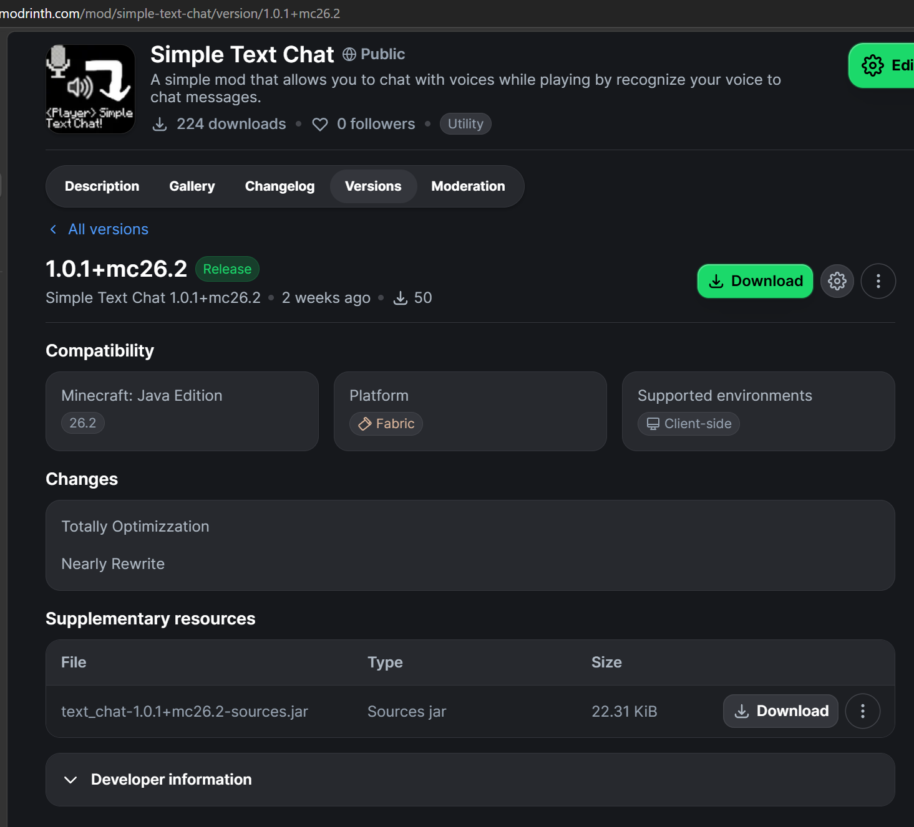
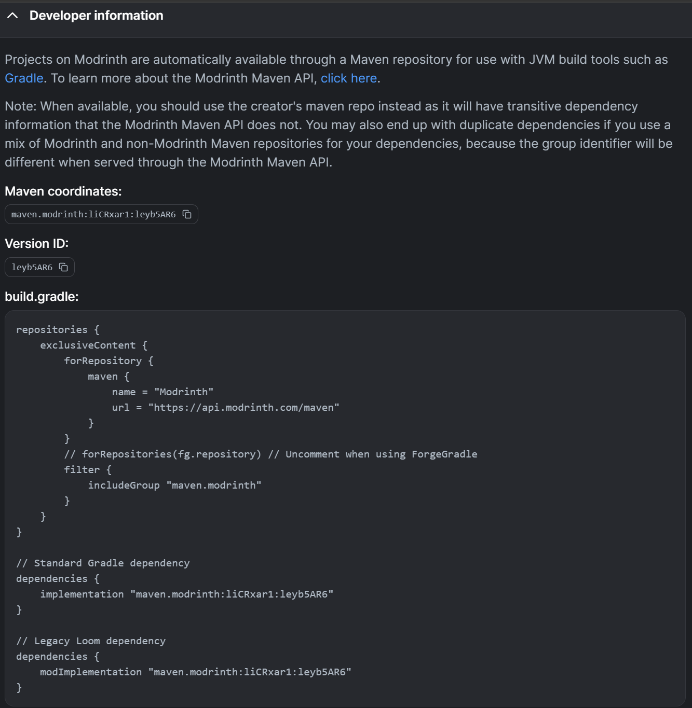

# API 文档

## 引入开发依赖

别想多了，我没买maven服务器

直接用Modrinth Maven

首先来到Modrinth上模组的发布页：

https://modrinth.com/mod/simple-text-chat/version

挑选你要接入的MC版本和Modloader对应的模组版本，进入详情页。



下面有个 Developer information ，点开它：



然后照着指引配置`build.gradle`即可。

## 修改配置

使用类`cn.yuang2714.simple_text_chat.client.config.Config`

目前本模组共有五个配置项：

- `isSetup`: `Boolean` 表示模组的配置是否完整。如果启动游戏时发现不完整，就会显示配置屏幕来修正配置。
- `modelStoragePath`: `String` 表示目前的模型的存储路径。里面的`${GAME_DIR}`会被替换成游戏的路径。
- `recognizationMode`: `Enum[HOLD_TO_SPEAK, PRESS_SEND, AUTO_DETECT]` 表示当前模组的转写模式。具体见语言翻译文件。
- `recognizationLanguage`: `Enum[CHINESE, ENGLISH]` 表示模型的输出语言。会影响模组处理输出结果的方式。
- `modelDictionary`: `String` 模型的词典（Grammar），用JSON列表表示。具体见Vosk文档。

对于每个配置项，`Config` 类里都有对应的Getter/Setter。直接调用即可。

## 基于事件总线的API

有两种结果类型，在`cn.yuang2714.simple_text_chat.api.SimpleTextChatRecognizationEvent`中声明

只要注册到Forge的事件总线即可，示例：

```java
@Mod.EventBusSubscriber(modid = "mymod", bus = Bus.FORGE, value = Dist.CLIENT)
public class SimpleTextChatProcessor {
    @SubscribeEvent
    public static void processPartial(SimpleTextChatRecognizationEvent.Partial event) {
        String text = event.getText(); //处理好的文本
        String raw = event.getJsonRaw(); //原始JSON文本
        //处理逻辑
    }
    
    @SubscribeEvent
    public static void processResult(SimpleTextChatRecognizationEvent.Result event) {
        String text = event.getText(); //处理好的文本
        String raw = event.getJsonRaw(); //原始JSON文本
        //处理逻辑
    }
}
```